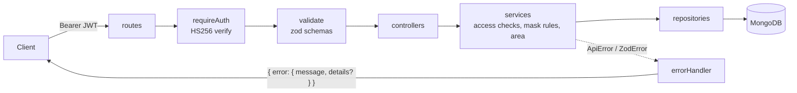

# PearlAI API

A REST service for image segmentation projects. Annotators sign up, create a project, register the images to label, and post masks as polygons (with holes) or COCO-style run-length encoding. The server validates each mask against the image it belongs to, computes its pixel area itself, and can rank an annotation by size within its image or summarise a project per annotator.

Stack: Node 22, TypeScript, Express 5, Mongoose 9 on MongoDB 7, zod 4 for request validation, pino for logs. Tests use Vitest and supertest against a real `mongod`.

## Quick start (Docker Compose)

```bash
cp .env.example .env
# put a real secret in .env, e.g. the output of:
openssl rand -hex 32          # -> JWT_SECRET=<that value>
docker compose up --build --wait
curl http://localhost:3000/api/health
```

Compose starts `mongo:7` and the API on port 3000. The API refuses to start without a `JWT_SECRET` of at least 32 characters, and the `.env.example` placeholder doesn't count. MongoDB is also published on `127.0.0.1:27017` so you can run the API outside Docker against it.

Stop everything with `docker compose down` (add `-v` to drop the database volume).

## Running without Docker

Requires Node 22.12+ (see `.nvmrc`) and a MongoDB you can reach.

```bash
npm ci
cp .env.example .env          # set JWT_SECRET; MONGODB_URI defaults to localhost:27017
npm run dev                   # tsx watch on src/index.ts
# or
npm run build && npm start    # compiled output in dist/
```

`.env` is loaded with Node's `process.loadEnvFile`. Variables that are already set in the environment take precedence.

| Variable | Default | Notes |
| --- | --- | --- |
| `PORT` | `3000` | |
| `MONGODB_URI` | none | Required to reach the database. The API still serves `/api/health` while disconnected. |
| `JWT_SECRET` | none | Required, at least 32 characters. |
| `JWT_EXPIRES_IN` | `1h` | `<number><s\|m\|h\|d>`, e.g. `15m`, `7d`. |
| `LOG_LEVEL` | `info` | Any pino level. |

## Tests

```bash
docker compose --profile test run --rm test
```

That builds the `test` stage of the Dockerfile and runs the full suite against the Compose MongoDB. To run it on your machine instead, point `TEST_MONGODB_URI` at any MongoDB server. Each API test file creates and drops its own database there.

```bash
TEST_MONGODB_URI=mongodb://127.0.0.1:27017 npm test
npm run test:unit             # pure functions only, no database needed
npm run lint && npm run typecheck
```

The suite covers the area maths, the segmentation and request schemas, token signing and verification, the error handler, and the HTTP API end to end. The end-to-end tests include ownership rules, the auth edge cases and the validation failures shown below.

## How a request flows



- **Routes** compose middleware. `/api/health` and `/api/auth/*` are public. `/api/projects`, `/api/images` and `/api/annotations` sit behind `requireAuth`.
- **Validation** is declarative: each route names the zod schema for its body or query, and the parsed value replaces `req.body` / `req.query`.
- **Services** hold the rules: who may see what, mask versus image checks, and server-side area. **Repositories** are thin wrappers over the Mongoose models.

## Access model

- Everyone who signs up is an `annotator`. The signup endpoint rejects a `role` field, so the only way to make an `admin` is to set `role: "admin"` on the user document in MongoDB.
- A project belongs to the user who created it. Images and annotations inherit access from their project.
- Annotators see only their own projects. Admins see all of them.
- A resource you can't access answers **404, not 403**, so ids can't be probed.
- `createdBy` on projects and annotations always comes from the token, never from the request body.
- Tokens are HS256 only, carry `sub`, `email`, `role` and `name`, and expire after `JWT_EXPIRES_IN`.
- Passwords are hashed with bcrypt (cost 12) and must be 8 to 72 bytes. bcrypt ignores anything after byte 72.
- Logging in with an unknown email takes as long as a wrong password.

## Mask rules

| Form | Shape | Checks | Area |
| --- | --- | --- | --- |
| `polygon` | `polygons: [{ rings: [outer, ...holes] }]`, each ring 3+ `[x, y]` points | Every point within `0..width` × `0..height` of the target image. Rings close implicitly. | Shoelace area of the outer ring minus its holes, summed over polygons |
| `rle` | `size: [height, width]`, `counts: [bg, fg, bg, fg, ...]` | `size` equals the image's dimensions, and the counts add up to exactly `height × width` | Sum of the odd (foreground) runs |

A client may send `area`. If it disagrees with the computed value (beyond 1e-6), the request is rejected. The stored area is always the server's. Posting an annotation marks its image `annotated`, and new images always start `unassigned`.

## API

Base URL: `http://localhost:3000/api`. Errors always look like `{ "error": { "message": "...", "details": ... } }`. 5xx responses never include internal error text.

| Method | Path | Auth | Purpose |
| --- | --- | --- | --- |
| GET | `/health` | none | Service and database state |
| POST | `/auth/signup` | none | `{ name, email, password }`, returns `{ user, token }` |
| POST | `/auth/login` | none | `{ email, password }`, returns `{ user, token }` |
| POST | `/projects` | token | `{ name, description? }` |
| GET | `/projects/:id` | token | One project |
| GET | `/projects/:id/stats` | token | Image and annotation counts, per-annotator breakdown |
| POST | `/projects/:projectId/images` | token | `{ images: [{ uri, width, height, assignedTo?, metadata? }] }`, 1 to 1000 per call. `uri` must be http(s), `s3:` or `gs:` |
| GET | `/images/:id` | token | One image |
| POST | `/annotations` | token | `{ image, label, segmentation, project?, area?, metadata? }` |
| GET | `/annotations` | token | Filters `label`, `annotator`, `imageId`, `projectId`. Paging `page` (from 1) and `limit` (1 to 100, default 20) |
| GET | `/annotations/:id` | token | One annotation |
| GET | `/annotations/:id/rank` | token | 1-based rank by area among the annotations on the same image |

### Examples

These exchanges were captured from the Compose stack. Tokens are shown as `<jwt>`, the per-run email suffix is dropped, and Mongo's `__v` and timestamps are trimmed.

Sign up (login returns the same shape):

```http
POST /api/auth/signup
{ "name": "Ada Annotator", "email": "ada@example.com", "password": "correct horse battery" }
```
```json
201
{ "user": { "id": "6af19e4aba1c9c9444ba8252", "name": "Ada Annotator", "email": "ada@example.com", "role": "annotator" },
  "token": "<jwt>" }
```

Create a project and register images:

```http
POST /api/projects
Authorization: Bearer <jwt>
{ "name": "Street scenes", "description": "Dashcam frames, cars and pedestrians" }
```
```json
201
{ "_id": "6af19e4aba1c9c9444ba8253", "name": "Street scenes", "description": "Dashcam frames, cars and pedestrians",
  "status": "active", "createdBy": "6af19e4aba1c9c9444ba8252" }
```

```http
POST /api/projects/6af19e4aba1c9c9444ba8253/images
Authorization: Bearer <jwt>
{ "images": [ { "uri": "s3://frames/0001.png", "width": 640, "height": 480 },
              { "uri": "https://example.com/frames/0002.png", "width": 640, "height": 480 } ] }
```
```json
201
{ "inserted": 2,
  "images": [ { "_id": "6af19e4aba1c9c9444ba8254", "project": "6af19e4aba1c9c9444ba8253", "uri": "s3://frames/0001.png",
                "width": 640, "height": 480, "status": "unassigned" },
              { "_id": "6af19e4aba1c9c9444ba8255", "...": "..." } ] }
```

A polygon with a hole: a 200×120 box minus a 40×40 window is 22,400 px.

```http
POST /api/annotations
Authorization: Bearer <jwt>
{ "image": "6af19e4aba1c9c9444ba8254", "label": "car",
  "segmentation": { "type": "polygon", "polygons": [ { "rings": [
    [[100,200],[300,200],[300,320],[100,320]],
    [[150,240],[190,240],[190,280],[150,280]] ] } ] } }
```
```json
201
{ "_id": "6af19e4aba1c9c9444ba8256", "project": "6af19e4aba1c9c9444ba8253", "image": "6af19e4aba1c9c9444ba8254",
  "label": "car", "segmentation": { "type": "polygon", "polygons": [ "..." ] },
  "area": 22400, "createdBy": "6af19e4aba1c9c9444ba8252" }
```

RLE on the same 640×480 image. The runs add up to 307,200 px and the foreground is 1,200 + 800:

```http
POST /api/annotations
Authorization: Bearer <jwt>
{ "image": "6af19e4aba1c9c9444ba8254", "label": "pedestrian",
  "segmentation": { "type": "rle", "size": [480, 640], "counts": [5000, 1200, 300200, 800] } }
```
```json
201
{ "_id": "6af19e4aba1c9c9444ba8257", "label": "pedestrian", "area": 2000, "...": "..." }
```

Query, rank and stats:

```http
GET /api/annotations?projectId=6af19e4aba1c9c9444ba8253&label=car&limit=10
```
```json
200
{ "page": 1, "limit": 10, "total": 1, "items": [ { "_id": "6af19e4aba1c9c9444ba8256", "label": "car", "area": 22400, "...": "..." } ] }
```

```http
GET /api/annotations/6af19e4aba1c9c9444ba8256/rank
```
```json
200
{ "annotationId": "6af19e4aba1c9c9444ba8256", "imageId": "6af19e4aba1c9c9444ba8254", "area": 22400, "rank": 1, "total": 2 }
```

```http
GET /api/projects/6af19e4aba1c9c9444ba8253/stats
```
```json
200
{ "projectId": "6af19e4aba1c9c9444ba8253", "images": 2, "annotations": 2,
  "perAnnotator": [ { "annotator": "6af19e4aba1c9c9444ba8252", "count": 2,
                      "user": { "name": "Ada Annotator", "email": "ada@example.com" } } ] }
```

What the guards look like:

| Request | Status | Body |
| --- | --- | --- |
| `GET /api/projects/:id` with no token | 401 | `{"error":{"message":"Authentication required"}}` |
| The same project, as a different user | 404 | `{"error":{"message":"Project does not exist"}}` |
| Polygon point at `(700, 500)` on a 640×480 image | 400 | `{"error":{"message":"polygon points must lie within the 640x480 image"}}` |
| Signup with `"role": "admin"` | 400 | `{"error":{"message":"Validation error","details":[{"code":"unrecognized_keys","keys":["role"],...}]}}` |

## Logging

pino with pino-http writes one line per request (`METHOD URL STATUS`): 2xx/3xx at `info`, 4xx at `warn`, 5xx at `error`. Health checks aren't logged. Requests carry an id, taken from `X-Request-Id` when the client sends one.

## Project layout

```
src/
  index.ts, app.ts         server bootstrap, middleware stack
  config/                  env schema, .env loading, Mongo connection
  routes/ controllers/     HTTP surface
  middleware/              requireAuth, validate, errorHandler
  services/                access rules, mask checks, area, stats
  repositories/ models/    Mongoose access and schemas
  validation/              zod schemas for requests and segmentations
  lib/                     tokens, access helpers, ApiError, logger
  utils/area.ts            polygon (shoelace) and RLE area
tests/
  unit/                    pure functions
  api/                     supertest against a real mongod
MODEL.md                   collections, fields and indexes
```

## License

MIT, see [LICENSE](LICENSE).
