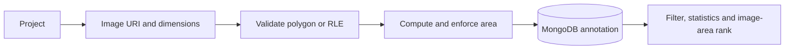

# Annotation mask store

A TypeScript/Express API for organizing image annotations in MongoDB. Store polygon masks with holes or numeric COCO-style RLE, compute mask area on the server, filter annotations, and rank masks by area within an image. It stores annotations; it does not run an AI model or render an annotation canvas.

## A small worked mask

For a 3-pixel-wide, 2-pixel-high image, this RLE describes six pixels with three foreground pixels:

```json
{"type":"rle","size":[2,3],"counts":[1,2,2,1]}
```

Counts alternate background/foreground, starting with background. Their total must equal `height × width`; their odd-indexed sum is the area. Polygon area uses the shoelace formula and subtracts holes. The API always computes area; an optional supplied area must be finite, positive and match within `1e-6`.

## Run locally

Use Node 22 and an existing local MongoDB instance. An Atlas account is optional, not a prerequisite.

```sh
npm ci --ignore-scripts
cp .env.example .env
npm run dev
```

The example connects to `mongodb://127.0.0.1:27017/annotation_masks` and listens on `127.0.0.1:3000`. Startup waits for MongoDB and exits if connection fails. Configure `MONGODB_URI`, `PORT`, and optionally `HOST` in `.env`. Keep credentials out of source control.

```sh
npm run build
npm start
npm test
```

## Request flow



Create a project, add image metadata, then use the returned image ID when posting an annotation:

```sh
curl -X POST http://127.0.0.1:3000/api/projects \
  -H 'Content-Type: application/json' -d '{"name":"Synthetic shapes"}'

curl -X POST http://127.0.0.1:3000/api/annotations \
  -H 'Content-Type: application/json' \
  -d '{"image":"REPLACE_WITH_IMAGE_ID","label":"shape","segmentation":{"type":"rle","size":[2,3],"counts":[1,2,2,1]}}'
```

A successful annotation returns HTTP 201 with its stored document and `area: 3`. Replace the placeholder with an actual ObjectId from an image created with matching dimensions. Image URIs are metadata; the API does not download or upload image files. The [Postman collection](.postman/PerleAI.postman_collection.json) provides the remaining request bodies.

| Route | Purpose |
| --- | --- |
| `GET /api/health` | Basic process health |
| `POST /api/projects` | Create project |
| `GET /api/projects/:id` | Read project |
| `GET /api/projects/:id/stats` | Image, annotation and per-annotator counts |
| `POST /api/projects/:projectId/images` | Insert image metadata in bulk |
| `GET /api/images/:id` | Read image metadata |
| `POST /api/annotations` | Validate and store mask |
| `GET /api/annotations/:id` | Read mask |
| `GET /api/annotations` | Filter by `label`, `annotator`, `imageId`, `projectId`; paginate with `page` and `limit` |
| `GET /api/annotations/:id/rank` | Competition rank: one plus the count of larger masks on the same image |

Pagination requires positive integers and a limit of 1–100. Query parameters must be single strings; nested MongoDB operators and repeated values are rejected. Ties share a rank, so areas 10, 10, 5 rank 1, 1, 3. See [MODEL.md](MODEL.md) for schema fields and indexes.

## Evidence and boundaries

Five Node test groups pass: complete/invalid RLE, polygon holes and invalid coordinates, and local HTTP rejection of query operators/invalid pagination. TypeScript compilation passes. Tests do not connect to MongoDB; persistence, aggregation and concurrent writes have not been integration-tested.

This is an unauthenticated local prototype. `createdBy` is a caller-supplied reference, not authenticated identity; project statistics may include stored user emails. Do not expose real annotation or user data. Hosting requires authentication, project permissions, origin restrictions and rate limits. Image bulk input validation, polygon topology/bounds, atomic annotation/status updates and large-dataset pagination also need further work. Polygons are summed independently, so overlaps are not unioned. There is no inference, training, mask editor, or compressed-string RLE decoder.
